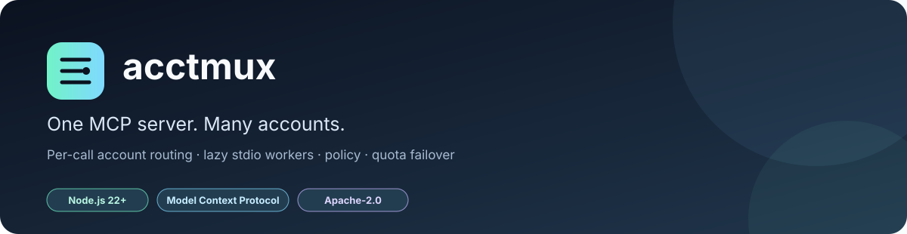
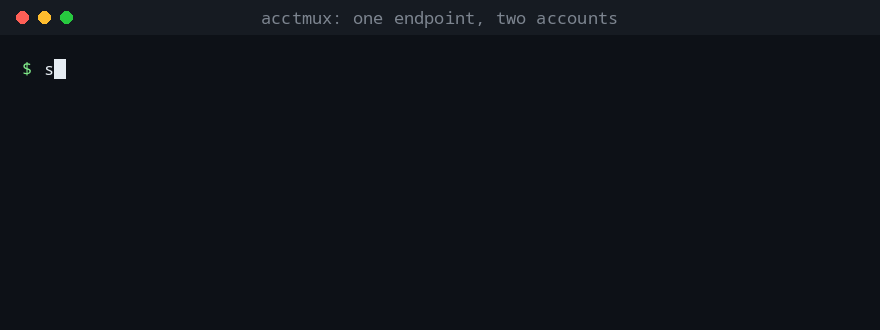
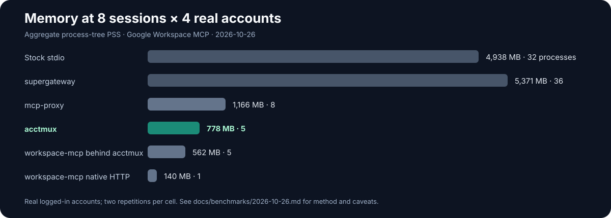

<!-- Keep the first screen focused: what it is, why it matters, and a real demo. -->
<p align="center">
  
</p>

<p align="center">
  <strong>One MCP server. Many accounts. One explicit <code>account</code> argument.</strong><br>
  Route calls to isolated stdio workers, share one tool surface across coding-agent sessions, and apply per-account policy without forking the upstream server.
</p>

<p align="center">
  <a href="https://www.npmjs.com/package/acctmux"></a>
  <a href="https://github.com/AmanKRoy/acctmux/actions/workflows/test.yml"></a>
  <a href="LICENSE"></a>
  
  
</p>

<p align="center">
  
</p>

<p align="center">
  <a href="#install-in-30-seconds">Quick start</a> ·
  <a href="#benchmarks">Benchmarks</a> ·
  <a href="#features">Features</a> ·
  <a href="#security">Security</a> ·
  <a href="#documentation">Documentation</a>
</p>

> **Status: 0.1.0, experimental.** Tested mainly on Linux and used by the author. It is not yet a mature, independently audited product. See [known limitations](docs/LIMITATIONS.md).

## The problem

Many MCP servers expose one account per process. Connect two Google accounts, two Notion workspaces, or several API keys in multiple coding-agent sessions, and the naive setup duplicates both processes and tool schemas.

```text
Without acctmux                         With acctmux

Claude Code ── server: work             Claude Code ┐
Claude Code ── server: personal         OpenCode    ├── acctmux ── worker: work
OpenCode    ── server: work             Codex       ┘             └─ worker: personal
OpenCode    ── server: personal                       one shared tool list
... every session × every account                   account="work" or "personal"
```

With **eight client sessions and four real Google accounts**, the latest benchmark measured **4,938 MB PSS across 32 processes** for stock stdio versus **778 MB across five processes** with acctmux. That's 6.3× less aggregate PSS in this workload. See the [2026-10-26 four-account benchmark](docs/benchmarks/2026-10-26.md) for the full comparison and methodology.

<p align="center">
  
</p>

## Install in 30 seconds

Requires **Node.js 22 or newer**.

```bash
npm install -g acctmux
acctmux init --preset google-workspace
acctmux
```

The initializer writes a starter config and a bearer token (file mode `600`), refuses to overwrite an existing config, and prints connection snippets for Claude Code, OpenCode, and Codex. The Google preset expects the upstream executable on your `PATH`:

```bash
npm install -g @dguido/google-workspace-mcp
```

Authenticate the Google account or profiles with the upstream package before calling their tools. For other presets, use `acctmux init --preset notion`, `tavily`, or `github`, then add the account credential files described by the initializer and [preset docs](docs/CONFIG.md#presets).

### Connect Claude Code

```bash
claude mcp add --transport http acctmux \
  'http://[::1]:18704/mcp' \
  --header "Authorization: Bearer $(cat ~/.config/acctmux/token)"
```

For OpenCode and Codex, use the snippets printed by `acctmux init`. The endpoint is local-only by default; do not publish the port to a network.

### What the model sees

Each tool gets an optional `account` argument whose enum lists the configured accounts. For example:

```text
You:    Compare Drive storage on my work and personal accounts.
Model:  get_storage_quota(account="work")
        get_storage_quota(account="personal")
```

For upstreams where silently choosing a default account would be risky, set `requireAccount: true` to reject calls that omit the selector.

## Features

| Capability | What it gives you |
|---|---|
| **One shared tool surface** | One endpoint and one set of tool definitions across client sessions, with an explicit per-call account selector. |
| **Lazy, isolated workers** | A separate stdio child per active account. Workers are started on demand, reused across calls, and stopped after the idle timeout. |
| **Multiple upstream servers** | Combine different MCP servers behind one endpoint. Conflicting tool names are prefixed with the upstream name. |
| **Per-account tool policy** | Allow or deny tools for an account, such as letting a mailbox read but not send or delete. |
| **Account pools** | Route interchangeable API keys using round-robin, sticky, or usage-aware selection. |
| **Quota failover** | Move to another pool member on configured quota errors, with an explicit tool retry allowlist and cooldowns. |
| **Prompts and resources** | Forward upstream prompts and resources; resource URIs are namespaced by upstream and account. |
| **Credential discovery and templating** | Configure accounts as lists, maps, or directory scans; substitute `{account}` in arguments and environment values. |
| **Safer local transport** | Loopback binding, optional bearer authentication, Unix sockets, Origin/Host checks, and request-body limits. |
| **Fast failure and recovery** | Optional warm-up calls, clearer login-expiry errors, and exponential backoff for unavailable upstreams. |
| **MCP protocol compatibility** | One endpoint supports the 2026-07-28 protocol natively and older 2025-era clients through the SDK's stateless fallback. Listening clients can receive tool-list change notifications. |

Account selection is explicit, not round-robin, unless you configure a pool. Separate accounts often mean separate data and permissions; they are not interchangeable identities.

## Architecture

<p align="center">
  
</p>

A request follows this path:

1. **Discover** the configured accounts and currently available upstream tools.
2. **Publish** a combined tool list with an account selector and any configured policy.
3. **Validate and route** the selected account, applying pool selection where configured.
4. **Spawn or reuse** that account's stdio worker, then forward the MCP call.
5. **Return the result** and stop the worker after it has been idle long enough.

The router opens its endpoint before all upstreams have finished loading. Requests wait for initial loading within a configured deadline; when no upstream is ready, the router returns a retryable service error rather than hanging startup indefinitely. When accounts or late-loading upstreams change the tool surface, clients using the supported change-subscription flow can be notified.

<p align="center">
  
</p>

## Configuration

The default config path is `~/.config/acctmux/config.json`. Override it with `ACCTMUX_CONFIG`. A complete minimal example is in [config.example.json](config.example.json), and the [configuration reference](docs/CONFIG.md) documents every key.

A small custom upstream example:

```json
{
  "auth": { "tokenFile": "~/.config/acctmux/token" },
  "upstreams": [
    {
      "name": "notion",
      "command": "npx",
      "args": ["-y", "@notionhq/notion-mcp-server"],
      "accounts": {
        "work": { "env": { "NOTION_TOKEN": "ntn_work_token_here" } },
        "personal": { "env": { "NOTION_TOKEN": "ntn_personal_token_here" } }
      },
      "defaultAccount": "work",
      "requireAccount": true,
      "policy": {
        "personal": {
          "deny": ["API-patch-page", "API-post-page", "API-patch-block-children"]
        }
      }
    }
  ]
}
```

Use credential files or your own secret-injection mechanism for real tokens; do not commit secrets into JSON config. The example above shows the config shape, not a recommendation to store live tokens there.

### Presets and examples

| Need | Start here |
|---|---|
| Google Workspace profiles | `acctmux init --preset google-workspace` · [Google example](config.google.example.json) |
| Notion workspaces | `acctmux init --preset notion` · [minimal example](config.example.json) |
| GitHub accounts | `acctmux init --preset github` · [policy example](config.github.example.json) |
| Several different upstreams | [Multi-upstream example](config.multi.example.json) |
| Interchangeable API keys and quota failover | [Pool example](config.pool.example.json) |

Preset versions are pinned where applicable. Presets are starting points; review upstream permissions and each policy before using them with real accounts.

### Run as a service

- **Linux / systemd user service:** [`systemd/acctmux.service`](systemd/acctmux.service)
- **Docker:** [`packaging/Dockerfile`](packaging/Dockerfile). The image contains the router, not your upstream servers; configure and provide those separately. The checked path uses a non-root user and a Unix socket.
- **macOS / launchd:** [`packaging/dev.acctmux.plist`](packaging/dev.acctmux.plist). The plist is linted in CI, but loading it under launchd is not yet tested.

Environment variables:

| Variable | Default | Purpose |
|---|---|---|
| `ACCTMUX_CONFIG` | `~/.config/acctmux/config.json` | Config path |
| `ACCTMUX_PORT` | `18704` | TCP port; loopback binding only |
| `ACCTMUX_IDLE_MS` | `150000` | Worker idle timeout |
| `ACCTMUX_MAX_BODY` | `33554432` | Maximum request body (32 MiB) |
| `ACCTMUX_TOKEN` | unset | Bearer token override |
| `ACCTMUX_SOCKET` | unset | Optional Unix socket path |

## Benchmarks

These numbers are measurements, not performance promises. The full reports explain the environment, methodology, repeated runs, and limitations.

### Aggregate process-tree memory

Eight client sessions, four real Google accounts, Google Workspace MCP upstream. The latest report is [2026-10-26](docs/benchmarks/2026-10-26.md):

| Setup | Aggregate PSS | Processes |
|---|---:|---:|
| Stock stdio, one server per session per account | 4,938 MB | 32 |
| `supergateway`, stateful, one per account | 5,371 MB | 36 |
| `mcp-proxy`, one instance per account | 1,166 MB | 8 |
| **acctmux** | **778 MB** | **5** |
| `workspace-mcp` native HTTP multi-account | 140 MB | 1 |
| `workspace-mcp` behind acctmux | 562 MB | 5 |

These memory figures come from the **2026-10-26 run with four real, logged-in Google accounts**. They are not directly comparable with the credential-free 2026-10-25 re-run, where upstream workers did not instantiate Google API clients. The native HTTP `workspace-mcp` implementation exposes 38 tools rather than the Google Workspace upstream's 54, so its feature surface differs. The `workspace-mcp behind acctmux` row measures that alternate upstream behind the router.

### Latency and tool surface

The **2026-10-26 four-account live run** measured session start at **2.3 ms** for acctmux versus **767 ms** for stock stdio. Warm calls were **386 ms** versus **388 ms**, respectively. Google API latency dominates the warm-call time, so the main difference is process reuse and tool-surface size rather than faster upstream API execution.

| Measurement | Result | Context |
|---|---:|---|
| Tool definitions per session, 4 accounts | 54 vs. 216 for per-account servers | One shared tool surface |
| Tool-schema parity | 54/54 | Same upstream descriptions and schemas apart from the injected selector |
| Router process, idle | ~49 MB PSS | Credential-free 2026-10-25 run |
| Router start until port accepts | ~243 ms | Credential-free startup test |
| Router start until first Google `tools/list` | ~1.24 s | Upstream list loading completes after the port opens |
| Fake-upstream calls | 39,825, no failures | Three-repetition offline test suite |

- [Latest benchmark: 2026-10-26, four real Google accounts](docs/benchmarks/2026-10-26.md)
- [Benchmark report: 2026-10-23, original live-account run](docs/benchmarks/2026-10-23.md)
- [Benchmark report: 2026-10-25, credential-free re-run](docs/benchmarks/2026-10-25.md)
- Reproduce with `node scripts/bench.mjs`; see the report for setup and exact commands.

<p align="center">
  
</p>

## Tested with

| Upstream | What has been exercised |
|---|---|
| [`@dguido/google-workspace-mcp`](https://www.npmjs.com/package/@dguido/google-workspace-mcp) 3.4.4 | Four real Google accounts in the 2026-10-26 scaling benchmark; schema parity and live checks |
| [`taylorwilsdon/google_workspace_mcp`](https://github.com/taylorwilsdon/google_workspace_mcp) `workspace-mcp` 2.1.2 | Benchmark and interoperability checks |
| `tavily-mcp` | Six API keys in a pool; quota failover tested with the documented quota-limit error |
| Official Notion MCP | One workspace; write tools denied by policy in the author's deployment |
| `github-mcp-server` | One account; `delete_file` and `merge_pull_request` denied by policy in the author's deployment |

The first two have dedicated benchmark/interop evidence; the final three are the author's deployment examples, not a claim of broad production validation. Other upstreams may work, but are untested.

## Security

> [!WARNING]
> **Treat acctmux as a local trust boundary.** Any process that can authenticate to the endpoint can invoke the tools and accounts configured there, including destructive tools. Use bearer authentication and restrictive local permissions; never expose the endpoint to a network without a deliberate authentication and access-control design.

- `acctmux init` creates a bearer token by default. The token file is mode `600`; group/world-readable token files are refused.
- Requests without a valid token are rejected before the body is read. Token comparison uses constant time.
- TCP binds to loopback only (`::1` by default, or `127.0.0.1` when configured). An optional Unix socket can be used instead or as well; its directory and socket permissions matter.
- Requests with an `Origin` header, a non-loopback `Host`, or a content type other than `application/json` are rejected.
- Request bodies are capped at 32 MiB by default.
- Child processes receive an allowlisted environment, with configured account and service variables added.
- The router does not read upstream credential stores. It does read its own bearer-token file and, for usage-aware pools, configured key files used only for the configured usage URL.
- Per-account `allow`/`deny` policy is a useful guardrail, not a replacement for upstream credentials, least privilege, or client-side review.

Generate a token manually if needed:

```bash
install -d -m 700 ~/.config/acctmux
openssl rand -hex 32 > ~/.config/acctmux/token
chmod 600 ~/.config/acctmux/token
```

See [SECURITY.md](SECURITY.md) for reporting vulnerabilities and [Architecture: trust boundaries](docs/ARCHITECTURE.md#trust-boundaries) for implementation details.

## Related projects

The MCP ecosystem moves quickly, and the projects below solve overlapping but different problems. This is a short orientation, not a leaderboard.

- **[Claude Code](https://github.com/anthropics/claude-code)** and **[OpenCode](https://github.com/anomalyco/opencode)** are coding agents that can connect to MCP servers; acctmux sits behind the client as a local server router.
- **[mohanagy/miftah](https://github.com/mohanagy/miftah)** is a multi-account credential broker with profile management and credential-handling features. Its profile-selection model differs from acctmux's per-call selector.
- **[mcp-account-router](https://github.com/antoniofulg/mcp-account-router)** focuses on failover across ordered profiles and a limited read-only tool set.
- **[supergateway](https://github.com/supercorp-ai/supergateway)** and **[mcp-proxy](https://github.com/punkpeye/mcp-proxy)** bridge or proxy MCP transports; their process and tool-surface trade-offs are included in the benchmark reports.
- **[Model Context Protocol](https://modelcontextprotocol.io/)** is the protocol acctmux routes.

Choose the tool that fits the trust model and deployment. If native multi-account support in an upstream already solves your use case, a second router may not be necessary.

## Development

Clone the repository and install dependencies:

```bash
git clone https://github.com/AmanKRoy/acctmux.git
cd acctmux
npm ci
npm test
npm run lint
```

The test suite uses a fake upstream and does not require Google, Notion, GitHub, or Tavily credentials. CI covers Node.js 22 and 24, and runs on macOS as well as Linux-specific checks where available.

Contributions and bug reports are welcome. Read [CONTRIBUTING.md](CONTRIBUTING.md) first. For security issues, use private vulnerability reporting as described in [SECURITY.md](SECURITY.md), not a public issue.

## Documentation

- [Configuration reference](docs/CONFIG.md)
- [Architecture and design decisions](docs/ARCHITECTURE.md)
- [Known limitations and alternatives](docs/LIMITATIONS.md)
- [Benchmarks and methodology](docs/benchmarks/)
- [Setup guide for AI agents](docs/SETUP-FOR-AGENTS.md)
- [Review log](docs/REVIEW.md)
- [Roadmap](docs/ROADMAP.md)
- [Changelog](CHANGELOG.md)

## License

Apache-2.0. See [LICENSE](LICENSE) and [NOTICE](NOTICE).
