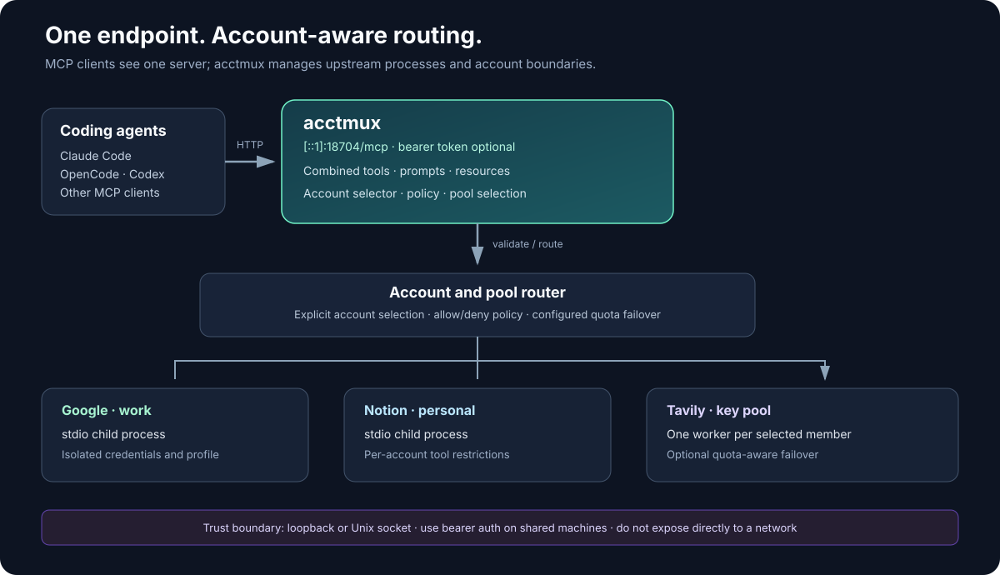
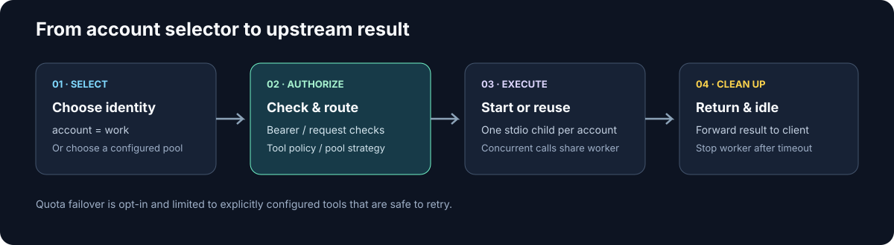

# Architecture

## Goal
One shared MCP endpoint for N accounts of the same MCP server and M client sessions, with RAM and tool-definition cost that does
not scale with N x M.

## System overview





## Constraints discovered
1. `@dguido/google-workspace-mcp` ships one bundled `dist/index.js`, **stdio only**, and resolves its profile once
   at startup (`--profile` / `GOOGLE_WORKSPACE_MCP_PROFILE`). One process = one account. Multi-account in one
   process would require forking the bundle.
2. Stdio wrappers behave differently:
   - `supergateway` 4.2.0 (`--stateful`): **one stdio child per client session** -> no sharing (tested: 3 sessions = 3 children).
   - `mcp-proxy` 6.7.21: one shared child for all sessions (tested: 3 sessions, 6 concurrent calls = 1 child), but
     ~112 MB of wrapper overhead per instance, one instance per account, and it strictly validates
     `structuredContent` (breaks `get_status`, which returns `last_error: null`).
3. Each upstream child is ~155 MB fresh, ~180 MB after serving calls (googleapis is heavy).

## Design

```
tools/list  -> cached upstream list + injected `account` property (enum rebuilt per request)
tools/call  -> {account='default', ...args} -> child(account).request(tools/call, args)
```

- **Per-request HTTP**: `createMcpHandler` (MCP SDK v2) builds a fresh low-level `Server` per POST. A request that carries the
  2026-07-28 `_meta` envelope is served natively; anything else goes through the SDK's stateless 2025 fallback. No session table,
  restart-safe. Only POST is served; other methods get 405. The router's own checks (bearer token, Origin, Host, content type,
  body cap) run before the SDK handler, which does none of them. Clients that open `subscriptions/listen` get `tools/list_changed`
  from `handler.notify`, called when the account list changes or a late upstream loads.
- **Lazy children**: `children: Map<account, {client, timer, busy}>`. First call spawns (`entry.ready` promise is
  stored synchronously so concurrent first calls share one spawn). `busy` counter prevents idle-kill mid-call;
  `arm()` re-arms an unref'd timer after each call.
- **Tool cache**: right after the port opens the router loads every upstream in the background: it spawns the default account (then others, within a time budget of three connect timeouts, if it cannot start), runs `tools/list`, copies server
  info + instructions, and keeps it warm (idle-killed like any other). Not refreshed until restart (see limits).
- **No output validation**: results are forwarded with `client.request(..., CallToolResultSchema)` rather than
  `client.callTool`, which would validate `structuredContent` against the child's `outputSchema` (the `get_status` bug).
- **Account discovery** is a directory scan per request (two `existsSync` per profile). Source of truth is the
  package's own token layout, so there is nothing to register.

## Rejected alternatives
| Option | Why not |
|---|---|
| Template unit per account + `mcp-proxy` | M x 270 MB always on; M x 54 tool defs; per-account port map/clients |
| `supergateway` | child per session |
| Fork package for in-process multi-account | patching a 479 KB bundle, breaks every upstream update |
| Socket activation per account | fixes idle RAM only; still M x 54 tool defs and M client entries |
| Round-robin across accounts | accounts are not fungible |

## Alternatives to consider before using this
- Natively multi-account servers (e.g. `taylorwilsdon/google_workspace_mcp`, one process, HTTP, per-call account argument) and Google's official remote
  Workspace MCP servers remove the need for a router entirely, at the cost of a different tool surface and (for the former) a Python stack.
  This router keeps one tool surface for any stdio upstream (the default upstream is `@dguido/google-workspace-mcp`).

## Code layout
`router.mjs` handles `--help`/`--version`, then starts the rest. Modules in `lib/`:

| Module | Holds |
|---|---|
| `util.mjs` | package info, `~` expansion, `log`, error types |
| `config.mjs` | presets, defaults, config validation, bearer token |
| `accounts.mjs` | account discovery, default account, tool policy |
| `pool.mjs` | pool config, member selection, cooldown, usage lookup, failover loop; takes the call path as an argument, so it imports without a server or SDK |
| `runtime.mjs` | loads config and the MCP SDK, builds the per-upstream state |
| `workers.mjs` | per-account child processes, idle kill, upstream loading, forwarding a call |
| `surface.mjs` | the exposed tool/prompt/resource surface and the MCP server handlers |
| `http.mjs` | HTTP and Unix-socket front end, request checks, the SDK handler, change notifications |

## Failure modes
| Event | Behaviour |
|---|---|
| Child crashes | `client.onclose` removes it and the SDK rejects pending calls immediately (`Connection closed`, ~0.5 s measured); next call respawns |
| Child fails to start | 15 s connect timeout (`connectTimeoutMs`), `isError` result; the failure is cached 30 s (`failTtlMs`) so retries fail fast; the child's last stderr is logged (also when the failure makes the router exit; it waits 300 ms first) |
| Upstream hangs on `tools/list` at startup | cut off at the connect timeout; the port is already open and upstreams load in parallel in the background. A request waits for upstreams still on their first attempt for at most `loadWaitMs` (default 20 s), then is served from the upstreams that have loaded; with none loaded it gets `503` with `Retry-After: 5`. The fallback over accounts stops once a time budget of three connect timeouts is spent, and one attempt can finish after that |
| Every upstream fails to load | the router logs `no upstream available` and exits 1 once all first attempts have ended (so systemd restarts it). One working upstream keeps it running |
| Expired/revoked token | upstream starts an interactive OAuth flow and would block for up to 5 min. The router spots the login banner on the child's stderr (`authRequired`), kills the child and returns an actionable error (~3 s); the Google preset sets `BROWSER=true` and `XDG_CURRENT_DESKTOP=X-Generic` so `xdg-open` does not launch a browser even on GNOME or KDE. Re-auth with `... auth --profile <name>` |
| Router crashes | systemd `Restart=on-failure` (5 s); children are stdio pipes and die with it |
| Unknown account | `isError` result listing valid accounts |
| Client disconnects mid-call | `extra.signal` is forwarded to the child request, which cancels it; 5 min hard timeout. An explicit `notifications/cancelled` sent as a separate request is not honoured for 2025-era clients |

## Trust boundaries
- Binds loopback only (`::1`, or `127.0.0.1` with `host`). Auth is optional (`auth.tokenFile`, `auth.token` or `ACCTMUX_TOKEN`): with a token set, every request needs `Authorization: Bearer <token>`
  (constant-time compare of SHA-256 digests, 401 before the body is read, startup refuses a token file readable by others or a token under 16 characters).
  Without a token any local user/process can invoke any account's tools (including send/delete), which is acceptable only on a single-user machine.
  The token authenticates the caller to the router; it does not scope what that caller may do (use `policy` for that). Do not bind wider than loopback.
- Browser threat: a loopback port is reachable from web pages (cross-origin "simple" POSTs, DNS rebinding). The MCP SDK does
  not enforce Host/Origin by default and its content-type check is a substring match, so a `text/plain; x=application/json`
  POST would run tools. The router rejects any request with an `Origin` header, a non-loopback `Host`, or a non-exact
  `application/json` content type (CLI MCP clients send no `Origin`). Request bodies are capped (`ACCTMUX_MAX_BODY`).
- The router never reads an upstream's credential store (it only checks that account directories exist). It does read the bearer-token file, and, for pools with `usage`, the key files named in `usage.keyFile`, which it sends only to the configured usage URL.
- Children receive a filtered environment (per-upstream `envPass` regex; the google-workspace default is PATH, HOME, USER, LANG/LC_*, TZ, XDG_*, NODE_OPTIONS, GOOGLE_*).

## Known limits
- Tool list is cached at startup; upgrading the upstream package needs a router restart.
- Upstream `resources` and `prompts` are forwarded (default account only for `prompts/get` and `resources/list`). 2025-era clients are served per request and cannot be pushed `listChanged`; they see new accounts on their next `tools/list`. 2026-07-28 clients that listen are notified.
- Tool names are prefixed `<upstream>__` only when two *loaded* upstreams clash, so a name can change if an upstream that was slow or down at start loads later. Listening 2026-07-28 clients get `tools/list_changed` when that happens; other clients see it on their next `tools/list`. A request's `prompts`/`resources` capabilities and instructions come from the upstreams loaded when it arrived.
- Omitting `account` uses the default account, also for destructive tools; there is no per-tool "account required" switch yet.
- `subscriptions/listen` streams are capped by the SDK (1024); without auth any local process can fill the cap.
- The forward timeout is a fixed 300 s with no progress forwarding, so very long tools can fail.
- With `sh -c "... exec npx ..."` upstreams, whether child shutdown reaches the grandchild depends on npm's signal handling (untested).
- Idle default is 2.5 min: a 10 min idle keeps every touched account resident all day; a cold start costs about 2 s (see the benchmark).
- The startup child (first account) is kept warm and idle-killed like any other.
- `account` enum is rebuilt from disk per list, but the cached upstream tool list is single-account-derived
  (assumes all accounts expose the same tools; true while `GOOGLE_WORKSPACE_SERVICES` is uniform).
- A tool that already has a parameter named like the selector is refused at load; rename the selector (`selector`, globally or per upstream).
- No progress notification forwarding (stateless transport).
- Worst case RAM (all accounts active): RSS ~90 MB + M x ~180 MB; real marginal (PSS) ~30 MB + M x ~100 MB (~530 MB for 5).
- Context: the injected `account` enum costs ~35 tokens x 54 tools (~1.9k tokens). Claude Code already defers MCP tool schemas, so the
  54-vs-5x54 saving matters mainly for clients that load every schema (e.g. OpenCode).
